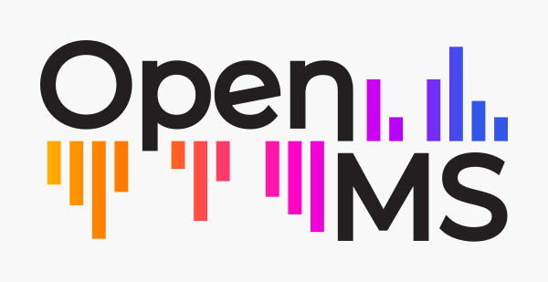
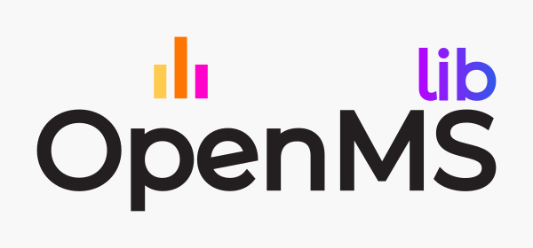
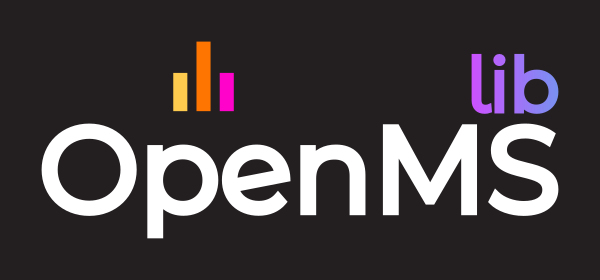
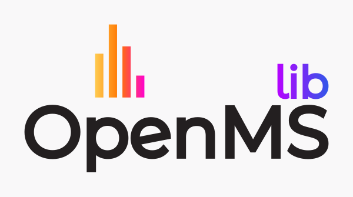
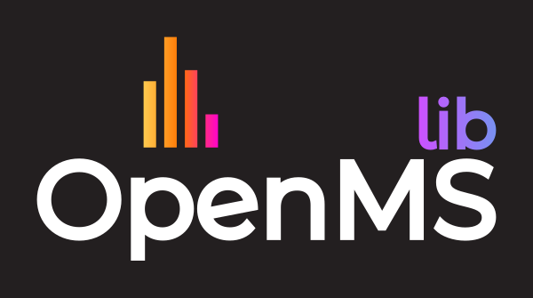
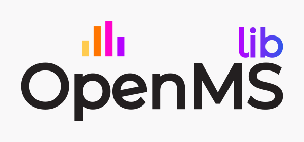
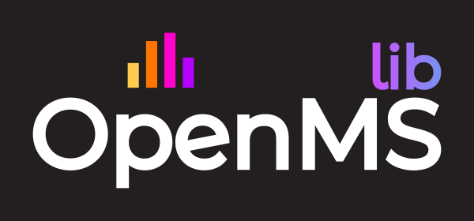
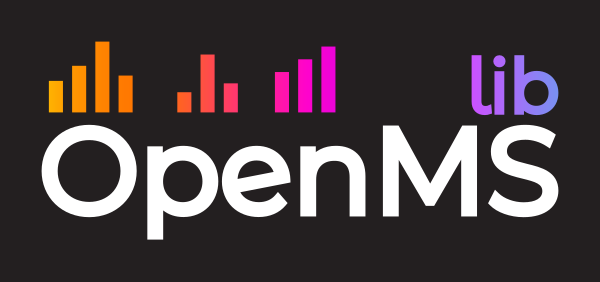

# Logo previews

Generated by `python scripts/make_previews.py` from the SVGs in [`logos/`](../logos).
Only **full** is the official logo. Everything else is a derived sublogo that is not yet approved.

| Preset | Standard (light backdrop) | White (dark backdrop) |
|---|---|---|
| **full** The official OpenMS logo: 6 letters + 16 bars, original positions. |  |  |
| **openms-lib-peak3** 3 bars, symmetric peak, solid yellow / orange / pink. |  |  |
| **openms-lib-peak4** 4 bars, skewed peak like pyopenms_viz, yellow -> pink gradient. |  |  |
| **openms-lib-peak4-tall** 4-bar gradient peak, but tall (about 1.4x the letter height), closer to the proportions of the pyopenms_viz logo. |  |  |
| **openms-lib-peak4-solid** 4 bars, symmetric peak, solid yellow / orange / pink / purple. |  |  |
| **openms-lib-plain** No bars: one-line "OpenMS" with "lib" above "MS". |  |  |
| **openms-lib-spectrum** "OpenMS" one line, spectrum bars above "Open", "lib" above "MS". |  |  |
