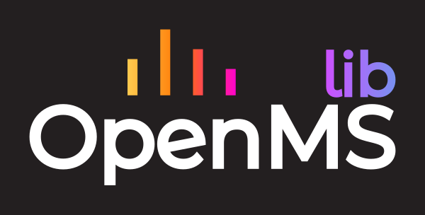
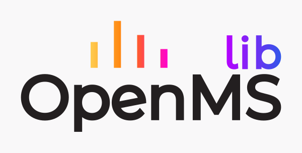
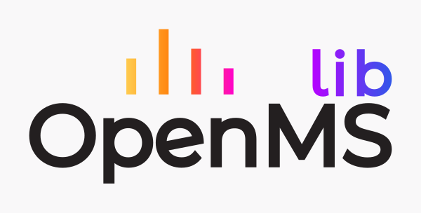
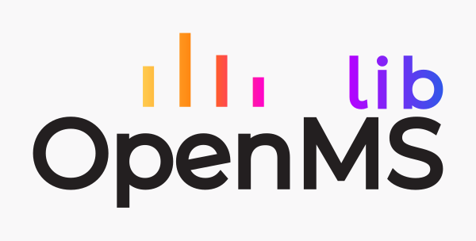
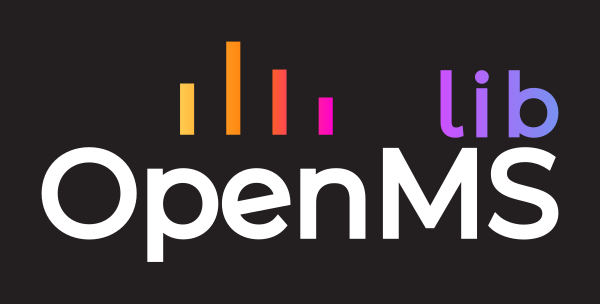
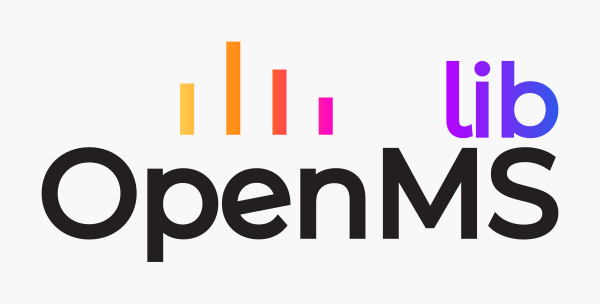
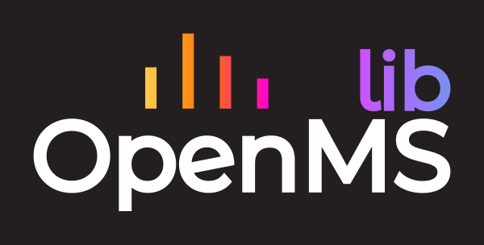

# Logo previews

Generated by `python scripts/make_previews.py` from the SVGs in [`logos/`](../logos).
Only **full** is the official logo. Everything else is a derived sublogo that is not yet approved.

| Preset | Standard (light backdrop) | White (dark backdrop) |
|---|---|---|
| **full** The official OpenMS logo: 6 letters + 16 bars, original positions. |  |  |
| **openms-lib-peak4-pen-pad15** peak4-pen with 15% padding each side: the bars cover the middle 70% of "pen". |  |  |
| **openms-lib-pen15-lib-s70-right** pen15 with "lib" 0.7 x MS size, right-aligned with S. |  |  |
| **openms-lib-pen15-lib-s70-right-t04** pen15 with "lib" 0.7 x MS size, right-aligned, +4 units letter spacing. |  |  |
| **openms-lib-pen15-lib-s70-right-t08** pen15 with "lib" 0.7 x MS size, right-aligned, +8 units letter spacing. |  |  |
| **openms-lib-pen15-lib-s70-right-t12** pen15 with "lib" 0.7 x MS size, right-aligned, +12 units letter spacing. |  |  |
| **openms-lib-pen15-lib-s70-right-t16** pen15 with "lib" 0.7 x MS size, right-aligned, +16 units letter spacing. |  |  |
| **openms-lib-pen15-lib-s80-right** pen15 with "lib" 0.8 x MS size, right-aligned with S. |  |  |
