# Logo previews

Generated by `python scripts/make_previews.py` from the SVGs in [`logos/`](../logos).
Only **full** is the official logo. Everything else is a derived sublogo that is not yet approved.

| Preset | Standard (light backdrop) | White (dark backdrop) |
|---|---|---|
| **full** The official OpenMS logo: 6 letters + 16 bars, original positions. |  |  |
| **openms-lib-peak4-pen-pad00** peak4-pen with 0% padding each side: the bars cover the middle 100% of "pen". | 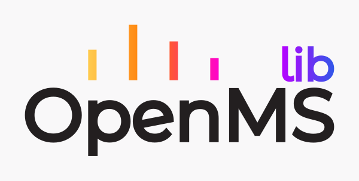 | 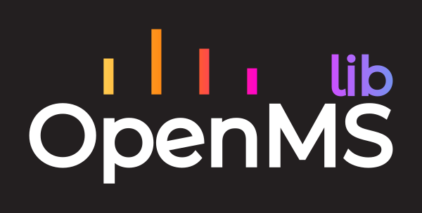 |
| **openms-lib-peak4-pen-pad05** peak4-pen with 5% padding each side: the bars cover the middle 90% of "pen". |  | 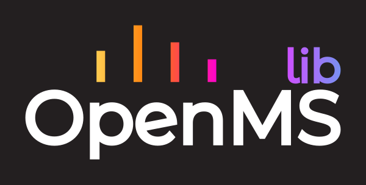 |
| **openms-lib-peak4-pen-pad10** peak4-pen with 10% padding each side: the bars cover the middle 80% of "pen". |  | 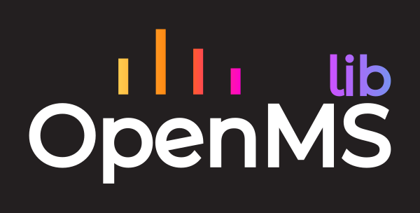 |
| **openms-lib-peak4-pen-pad15** peak4-pen with 15% padding each side: the bars cover the middle 70% of "pen". |  |  |
| **openms-lib-peak4-pen-pad20** peak4-pen with 20% padding each side: the bars cover the middle 60% of "pen". | 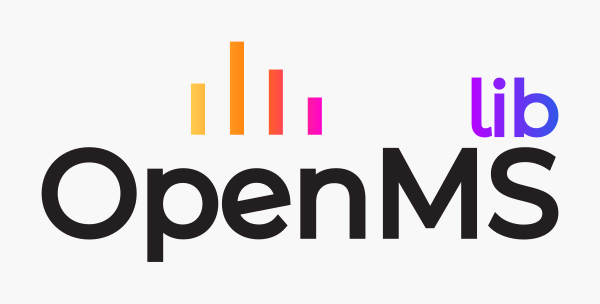 |  |
| **openms-lib-peak4-pen-pad25** peak4-pen with 25% padding each side: the bars cover the middle 50% of "pen". | 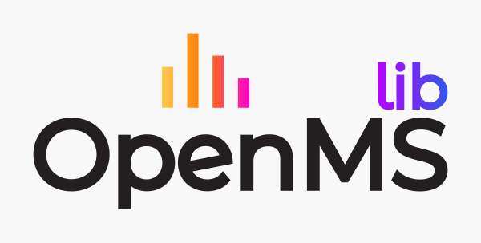 | 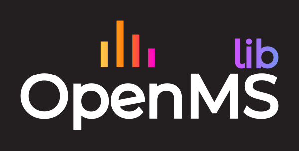 |
| **openms-lib-peak4-pen-pad30** peak4-pen with 30% padding each side: the bars cover the middle 40% of "pen". | 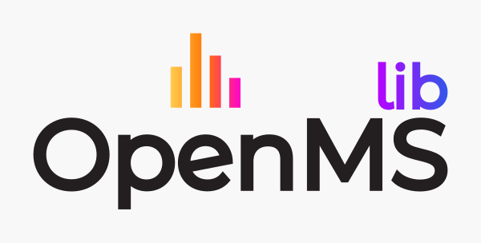 | 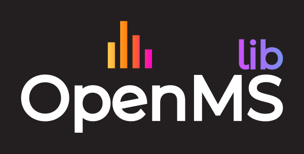 |
| **openms-lib-plain** No bars: one-line "OpenMS" with "lib" above "MS". | 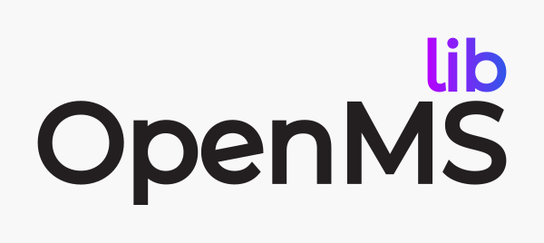 |  |
| **openms-lib-plain-span** No bars; "lib" spanning "MS". | 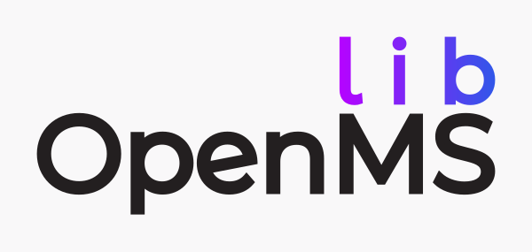 |  |
