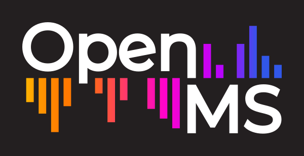
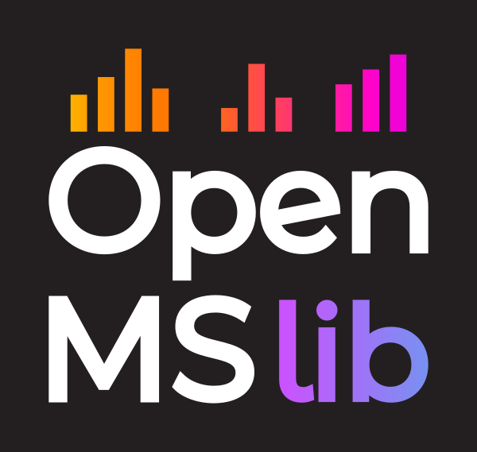
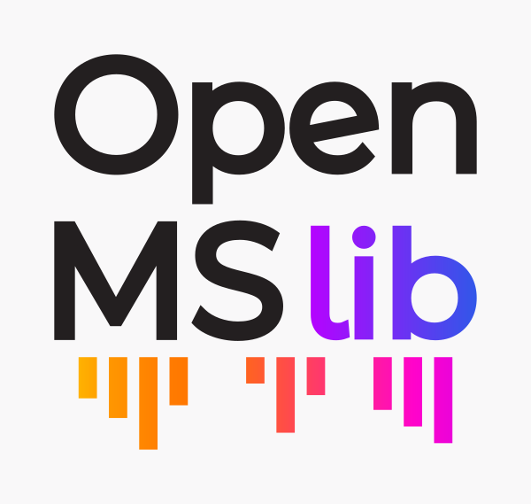
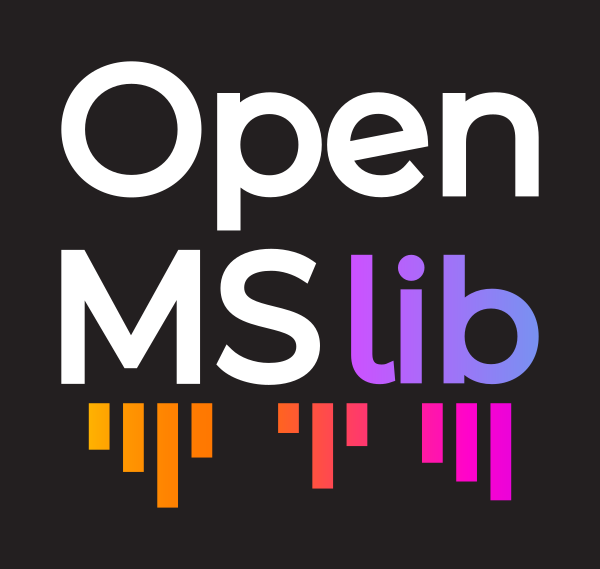
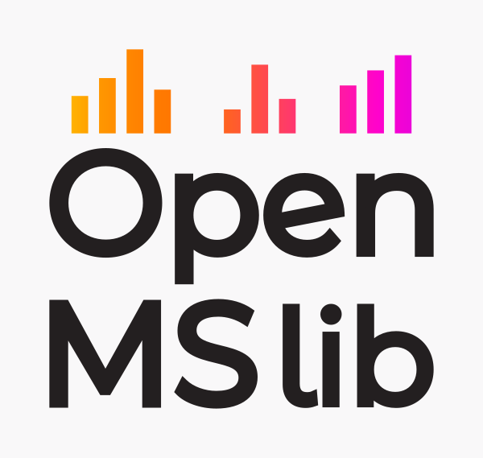
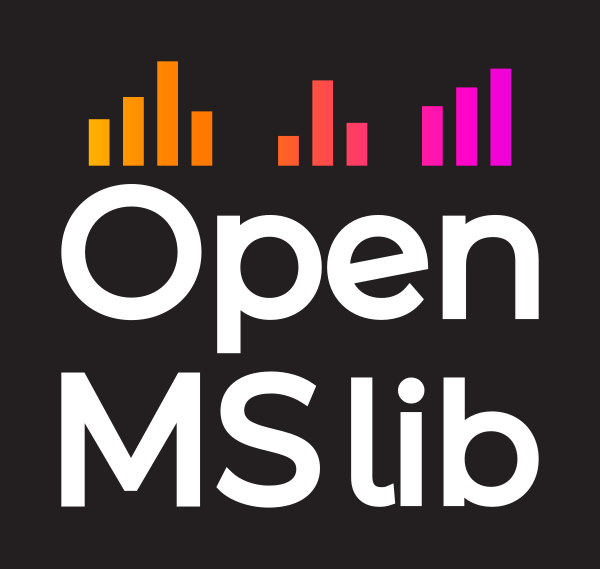
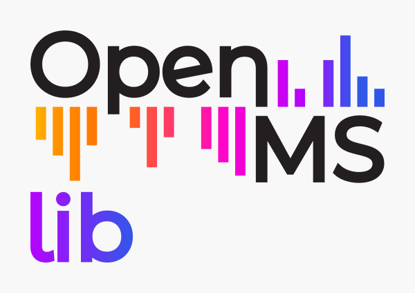
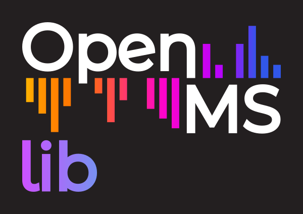
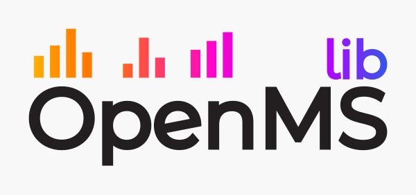

# Logo previews

Generated by `python scripts/make_previews.py` from the SVGs in [`logos/`](../logos).
Only **full** is the official logo. Everything else is a derived sublogo that is not yet approved.

| Preset | Standard (light backdrop) | White (dark backdrop) |
|---|---|---|
| **full** The official OpenMS logo: 6 letters + 16 bars, original positions. |  |  |
| **openms-lib-square-top** A: spectrum on top, "Open" / "MS lib". |  |  |
| **openms-lib-square-bottom** B: "Open" / "MS lib", spectrum hanging below (like the official bars). |  |  |
| **openms-lib-square-ink** D: like A, but "lib" in the letter colour; the bars carry all the colour. |  |  |
| **openms-lib-official-stack** C: the untouched official logo with "lib" as a third line under the hanging bars, left-aligned with "O", same letter size as "MS". |  |  |
| **openms-lib-spectrum** "OpenMS" one line, spectrum bars above "Open", "lib" above "MS". |  |  |
